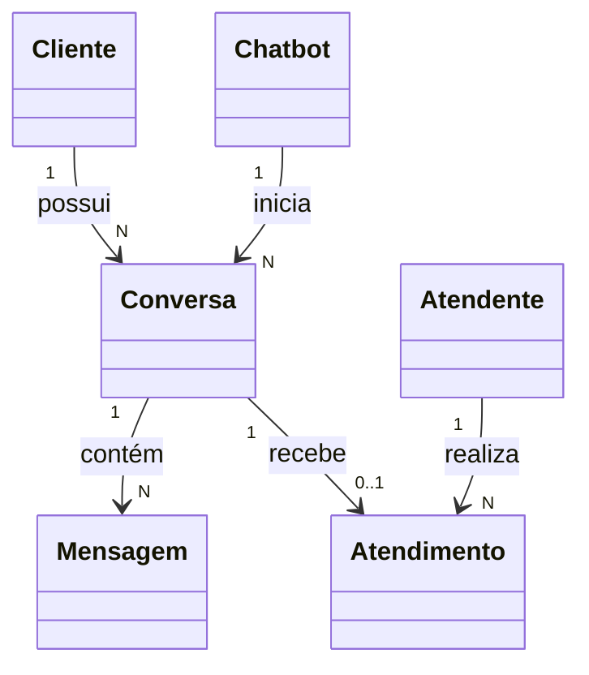
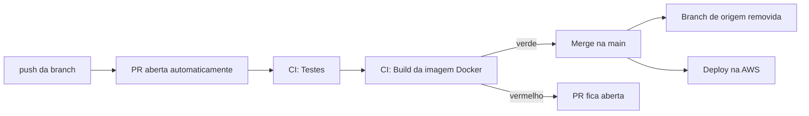

# Chatbot 

Aplicação backend **Spring Boot**, construída com Java 21 e Maven. Persistência via JPA/Hibernate em banco **PostgreSQL**, com modelo de domínio rico (Cliente → Conversa → Mensagem) aplicando encapsulamento e relacionamentos.

---

## Tech Stack

| Camada | Tecnologia | Versão | Finalidade |
|---|---|---|---|
| Linguagem | Java (JDK) | 21 | Runtime da aplicação |
| Framework | Spring Boot | 4.1.1 | Base da aplicação / autoconfiguração |
| Build | Maven (com Wrapper `mvnw`) | 3.9.16 | Build e gerenciamento de dependências |
| Web | Spring Web MVC | starter `spring-boot-starter-webmvc` | API REST (controllers, HTTP) |
| Persistência | Spring Data JPA | starter `spring-boot-starter-data-jpa` | Camada de acesso a dados / repositórios |
| ORM | Hibernate ORM | 7.4.5.Final* | Mapeamento objeto-relacional |
| Banco de dados | PostgreSQL | 16 | Banco da aplicação (runtime) |
| Banco de dados (testes) | H2 | 2.4.240* | Banco em memória, escopo `test` |
| Console do banco | Adminer | latest | Interface web em `http://localhost:8081` |
| Health check | Spring Boot Actuator | starter `spring-boot-starter-actuator` | `/actuator/health` para o load balancer |
| Container | Docker + Docker Compose | — | Build da imagem e stack local completa |
| Validação | Bean Validation | starter `spring-boot-starter-validation` | Validação de DTOs/entidades (`@Valid`, `@NotBlank`…) |
| Redução de código | Lombok | (plugin) | Getters/setters/construtores automáticos |
| Dev | Spring Boot DevTools | starter `spring-boot-devtools` | Auto-restart / hot reload em desenvolvimento |
| Servidor embutido | Apache Tomcat | 11.0.24* | Servlet container embutido (porta 8080) |
| Testes | Spring Boot Test Starters | `-data-jpa-test`, `-validation-test`, `-webmvc-test` | Testes de contexto/Web/Data/Validação |

> \* Versões reportadas em tempo de execução pelos logs do Spring Boot (gerenciadas pelo BOM do Spring Boot 4.1.1 — não fixadas manualmente no `pom.xml`).

### Starter usados no `pom.xml`

- `spring-boot-starter-webmvc` — API REST
- `spring-boot-starter-data-jpa` — JPA + Hibernate
- `spring-boot-starter-validation` — Bean Validation
- `spring-boot-starter-actuator` — health check
- `spring-boot-devtools` — hot reload (runtime, opcional)
- `org.postgresql:postgresql` — driver do banco (runtime)
- `com.h2database:h2` — banco em memória (escopo `test`)
- `org.projectlombok:lombok` — código boilerplate
- `*-test` starters — testes (JUnit + Spring Test)

---

## Estrutura do projeto

```
src/main/java/com/example/chatbot/
├── ChatbotApplication.java           # Classe principal (@SpringBootApplication)
├── config/
│   ├── CorsConfig.java               # CORS para o frontend
│   └── CorsProperties.java           # Propriedades app.cors.*
└── model/
    ├── Cliente.java                  # Cliente e suas conversas
    ├── Atendente.java                # Atendente e seus atendimentos
    ├── Chatbot.java                  # Chatbot que inicia conversas
    ├── Conversa.java                 # Sessão de conversa
    ├── Mensagem.java                 # Mensagem (imutável)
    ├── Atendimento.java              # Atendimento humano de uma conversa
    └── enums/
        ├── RemetenteMensagem.java
        ├── StatusConversa.java
        └── StatusAtendimento.java

src/main/resources/
├── application.properties            # Configuração padrão (PostgreSQL, CORS)
├── application-prod.properties       # Perfil de produção
└── static/index.html                 # Página inicial

src/test/java/com/example/chatbot/
├── ChatbotApplicationTests.java
├── config/CorsConfigTest.java        # Testes de preflight de CORS
└── model/AtendimentoTest.java        # Testes dos fluxos de chatbot e atendimento

Dockerfile                            # Build multi-stage da imagem
docker-compose.yml                    # PostgreSQL + Adminer + aplicação
pom.xml / mvnw / mvnw.cmd             # Build Maven
```

---

## Como executar

Pré-requisito: **JDK 21** configurado no ambiente. O Maven Wrapper usa o JDK definido em `JAVA_HOME` e baixa o Maven 3.9.16 definido em `.mvn/wrapper/maven-wrapper.properties`; não é necessário instalar Maven globalmente.

No Windows, configure `JAVA_HOME` para a pasta do JDK 21 e inclua `%JAVA_HOME%\bin` no `PATH`. Para configurar o JDK instalado no perfil do usuário, execute no PowerShell, substituindo o caminho pela pasta onde o JDK 21 está instalado:

```powershell
$jdkHome = "C:\caminho\para\jdk-21"
[Environment]::SetEnvironmentVariable("JAVA_HOME", $jdkHome, "User")
$jdkBin = Join-Path $jdkHome "bin"
$userPath = [Environment]::GetEnvironmentVariable("Path", "User")
if (($userPath -split ";") -notcontains $jdkBin) {
    [Environment]::SetEnvironmentVariable("Path", "$userPath;$jdkBin", "User")
}
```

Feche e reabra o terminal e confirme o JDK de `JAVA_HOME` e a versão do Maven Wrapper:

```powershell
& "$env:JAVA_HOME\bin\java.exe" -version
.\mvnw.cmd -version
```

O Java selecionado por `JAVA_HOME` deve ser a versão 21 e o Maven Wrapper deve indicar Maven 3.9.16. Se `java -version` simples exibir outra instalação, confira a ordem dos JDKs no `PATH` do Windows.

```bash
# Windows (PowerShell)
.\mvnw.cmd spring-boot:run

# Linux / macOS
./mvnw spring-boot:run
```

A aplicação sobe em **http://localhost:8080** (Tomcat, porta 8080).

> Alternativa via VS Code: abra a **Spring Boot Dashboard** → seção **Apps** → botão **▶ Run** no item `chatbot`.

---

## Docker

A imagem é construída em dois estágios — build com Maven e runtime com JRE 21 — e o cache de dependências do Maven fica em um volume do BuildKit, evitando rebaixar tudo a cada build.

```bash
docker compose up --build -d      # sobe banco + Adminer + aplicacao
docker compose ps
docker compose logs -f app
docker compose down               # para tudo
docker compose down -v            # para e apaga o volume do banco
```

---

## Testes

```bash
.\mvnw.cmd test
```

---

## Banco de dados (PostgreSQL)

O banco roda em container, junto com o Adminer para inspeção:

```bash
docker compose up -d
```

| Serviço | Porta | Credenciais |
|---|---|---|
| PostgreSQL 16 | `5432` | banco `chatbot`, usuário `postgres`, senha `postgres` |
| Adminer | `8081` | Sistema `PostgreSQL`, Servidor `db` |

A conexão é configurável por variáveis de ambiente: `DB_HOST`, `DB_PORT`, `DB_NAME`, `DB_USER` e `DB_PASSWORD` (padrões `localhost`, `5432`, `chatbot`, `postgres`, `postgres`).

> Nos **testes** o banco é o **H2 em memória** (`jdbc:h2:mem:testdb`), então `.\mvnw.cmd test` não precisa de Docker.

---

## Modelo de domínio



| Entidade | Papel |
|---|---|
| `Cliente` | Pessoa atendida e dona das conversas. O CPF nunca é exposto por completo — apenas via `getCpfMascarado()` |
| `Chatbot` | Inicia conversas para clientes enquanto estiver ativo |
| `Conversa` | Sessão do cliente; controla seu ciclo de vida e pode ser transferida para atendimento humano |
| `Mensagem` | Imutável; criada apenas por `Conversa.registrarMensagem(...)` |
| `Atendente` | Pessoa que assume conversas aguardando atendimento humano |
| `Atendimento` | Vincula uma conversa a um atendente e controla resolução e encerramento |

Os construtores de `Conversa`, `Mensagem` e `Atendimento` são de pacote e as coleções são expostas como listas imutáveis. Os métodos de domínio mantêm os relacionamentos e impedem a abertura de atendimento para conversas que não aguardam um atendente.

---

## CORS

O frontend roda em origem separada, então o CORS está configurado para `/api/**`.

| Propriedade | Padrão | Variável de ambiente |
|---|---|---|
| `app.cors.allowed-origins` | `http://localhost:3000,http://localhost:5173,http://localhost:4173` | `CORS_ALLOWED_ORIGINS` |
| `app.cors.allowed-methods` | `GET,POST,PUT,PATCH,DELETE,OPTIONS` | `CORS_ALLOWED_METHODS` |
| `app.cors.allowed-headers` | `Content-Type,Accept,Authorization,X-Trace-Id` | `CORS_ALLOWED_HEADERS` |
| `app.cors.exposed-headers` | `X-Trace-Id` | `CORS_EXPOSED_HEADERS` |
| `app.cors.max-age` | `3600` | `CORS_MAX_AGE` |
| `app.cors.allow-credentials` | `false` | `CORS_ALLOW_CREDENTIALS` |

Em ambientes publicados, defina `CORS_ALLOWED_ORIGINS` com o domínio do frontend — a variável de ambiente sobrescreve o padrão.

---

## Fluxo de trabalho (branches e CI)

**Regra do repositório:** no máximo **duas branches** — a `main` e **uma** branch de trabalho que será mergeada. Não se acumulam branches.

### Rotina

```powershell
# 1. Partir sempre da main atualizada
git checkout main
git pull

# 2. Criar a unica branch de trabalho
git checkout -b feat/minha-tarefa

# 3. Trabalhar, commitar e enviar
git add -A
git commit -m "feat: descreve a mudanca"
git push -u origin feat/minha-tarefa

# 4. Depois do merge (o CI já apagou a branch remota)
git checkout main
git pull
git branch -d feat/minha-tarefa
```

### O que o push dispara



| Workflow | Arquivo | Responsabilidade |
|---|---|---|
| **Abrir PR** | `.github/workflows/auto-pr.yml` | Cria a PR para a `main` a partir do push em qualquer branch; não duplica se já existir uma aberta |
| **CI** | `.github/workflows/ci.yml` | Roda `Testes` e `Build da imagem Docker`; em PR, faz o merge com squash, remove a branch de origem e limpa branches antigas já mergeadas |

- CI **verde** → merge automático na `main`, e o merge é o que dispara o deploy.
- CI **vermelho** → a PR permanece aberta e nada chega na `main`.

### Requisito no GitHub

Para que a PR seja criada automaticamente, é preciso habilitar em
**Settings → Actions → General → Workflow permissions**:

- ✅ Read and write permissions
- ✅ Allow GitHub Actions to create and approve pull requests

> O segundo item é obrigatório: sem ele o workflow `Abrir PR` falha com
> *"GitHub Actions is not permitted to create or approve pull requests"*.
